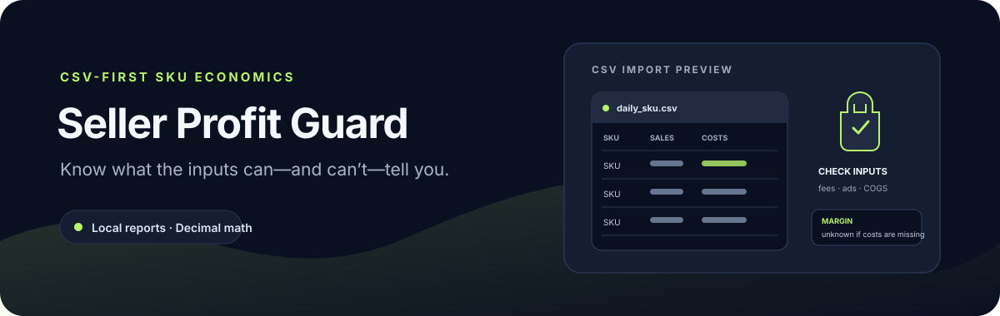

# Seller Profit Guard



**A CSV-first SKU economics ledger.** Import seller reports into a local SQLite database, calculate contribution margin and ad metrics with decimal arithmetic, and preview inventory or performance alerts.

[](https://github.com/jezannn16/seller-profit-guard/actions/workflows/ci.yml)

[Features](#what-it-does) · [Quick start](#quick-start) · [CSV format and formulas](#input-format) · [Telegram](#optional-telegram-delivery) · [Tests](#tests-and-ci) · [Data and scope](#data-and-scope)

## What it does

| Area | Available now |
| --- | --- |
| Import | Preview and import CSV; optional XLSX support with `openpyxl` |
| Validation | Map case-insensitive headers; reject negative sales, costs, inventory, and duplicate date/SKU rows |
| Economics | Calculate net sales, return rate, contribution margin, ROAS, and ACoS when inputs are complete |
| Inventory | Estimate days of cover from supplied stock and average daily units |
| Alerts | Margin/stock thresholds plus ROAS decline and ACoS growth across two periods; dry-run by default with configurable cooldown |
| Storage | Append-only daily SKU rows in local SQLite; no marketplace account connection |

Missing cost or returns inputs remain unknown where they affect a metric. The tool does not infer profit from revenue.

## Quick start

Requires Python 3.11 or newer.

```sh
python3 -m venv .venv
. .venv/bin/activate
python -m pip install -e '.[dev]'
# Optional, for XLSX input:
python -m pip install -e '.[xlsx]'
```

Run the included synthetic example:

```sh
python seller_profit_guard.py preview fixtures/daily_sku.csv
python seller_profit_guard.py --db /tmp/seller-demo.sqlite3 import fixtures/daily_sku.csv
python seller_profit_guard.py --db /tmp/seller-demo.sqlite3 dashboard
python seller_profit_guard.py --db /tmp/seller-demo.sqlite3 alerts \
  --min-margin 6000 --min-stock-days 7 --min-roas 10
```

The fixture has three rows. SKU-ALPHA has 17,500 net sales and 5,000 contribution margin; its ROAS uses supplied ad-attributed sales. SKU-BETA has unknown margin and ROAS because COGS and attributed ad sales are missing. Alerts print as dry-run and send nothing.

## Input format

One row per date and SKU. Required columns: `date` (`YYYY-MM-DD`), `sku`, `units`, and `gross_sales`. Optional columns: `returns`, `fees`, `logistics`, `ad_spend`, `ad_sales`, `cogs`, `stock`, and `avg_daily_units`. Monetary amounts accept decimal commas or dots. Rows with missing required cost inputs keep contribution margin unknown; missing `ad_sales` keeps ROAS and ACoS unknown.

The formulas and assumptions are:

```text
net sales            = gross sales - returns
contribution margin  = net sales - fees - logistics - ad spend - COGS
return rate          = returns / gross sales (unknown when returns are missing or gross sales are zero)
ROAS                 = ad-attributed sales / ad spend
ACoS                 = ad spend / ad-attributed sales
inventory cover      = latest stock / latest average daily units
ROAS trend alert     = current period ROAS < preceding equal-length period ROAS
ACoS trend alert     = current period ACoS > preceding equal-length period ACoS
```

Taxes, storage, payment costs, discounts, and other expenses must be included in an appropriate input before interpreting contribution margin. Inventory cover is a point-in-time estimate, not a demand forecast.
CSV export prefixes formula-like SKU text with an apostrophe for spreadsheet safety; if such a SKU is re-imported, remove that export-only prefix first.

## Tests and CI

```sh
pytest -q
ruff check .
```

Tests include the synthetic CSV fixture, real CLI subprocess runs with a temporary database, duplicate import handling, alert dry-run behavior, and XLSX parsing when the optional dependency is installed. They make no marketplace or Telegram requests.

Imports accept repeated `--map CANONICAL=HEADER` options on both `preview` and `import`, for example `--map date=День --map sku=Артикул --map gross_sales=Продажи --map units=Шт`. Canonical names include `date`, `sku`, `units`, `gross_sales`, `returns`, `fees`, `logistics`, `ad_spend`, `ad_sales`, `cogs`, `stock`, and `avg_daily_units`. `imports` prints local batch history with time and accepted/rejected counts. The chosen mapping is part of import identity.

Trend alerts compare each SKU's last `--trend-days` calendar days in the imported data with the preceding equal-length period (default: 7 days). They are emitted only when both periods have enough inputs to calculate the metric and ROAS decreased or ACoS increased. Set `--cooldown-hours` (default: 24) to control local alert suppression. For example, `alerts --trend-days 14 --cooldown-hours 48` compares two consecutive 14-day windows and suppresses repeated alerts for 48 hours.

## Optional Telegram delivery

Telegram delivery is a real external message. It requires `TELEGRAM_BOT_TOKEN` and `TELEGRAM_CHAT_ID` in a local `.env` file or secret manager; `.env` is ignored by Git. Never commit or paste credential values. Review the generated alert text and choose a private test chat before using `--send-telegram`:

```sh
cp .env.example .env
# Edit .env locally with your bot token and destination chat ID.
set -a; . .env; set +a
python seller_profit_guard.py --db /tmp/seller-demo.sqlite3 alerts \
  --min-margin 6000 --min-stock-days 7 --send-telegram
```

Sending is opt-in, uses one request per alert, and does not automatically retry ambiguous failures. `--commit-log` writes local cooldown entries and does not send messages. Partially accepted imports with rejected rows also produce a batch-specific alert; dry-run reports it without changing cooldown state. This repository has no Telegram live-send test.

## Data and scope

There is no Wildberries or Ozon API adapter, marketplace synchronization, price editing, ad management, or stock updates. On POSIX systems the SQLite database and CSV export are restricted to the current user (mode 0600); contents remain unencrypted, so avoid sensitive exports in shared directories. Identical file imports are idempotent, while overlapping date/SKU rows are rejected rather than overwritten.

See [demo steps](docs/demo.md) and the [synthetic CSV fixture](fixtures/daily_sku.csv).
